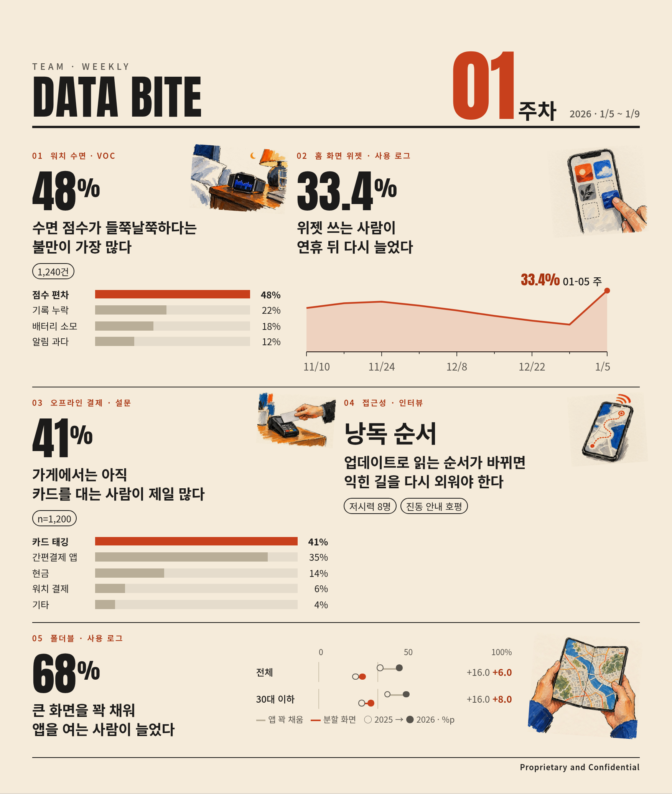

# dataBite-infographics

Data Bite 주간 덱(HTML)을 **한 장짜리 인포그래픽**(HTML 단일 파일 + PNG)으로 만드는 Claude Code 스킬입니다. Data Bite 전용입니다.



> 예시의 회사 · 제품 · 숫자는 모두 지어낸 가상 데이터입니다.

## 무엇이 고정이고 무엇이 바뀌나

| 고정(견본) | 주차마다 |
|---|---|
| 글자 크기 · 색 · 간격 · 머리/바닥 · 차트 모양 · 그림 화풍 (`assets/style.css`) | 내용(명세 `spec.json`) |
| 폭 210mm(A4) | 캔버스 길이: 내용이 많으면 길어지고 적으면 짧아짐 |

배치 맞춤을 반복하지 않습니다. 줄 높이를 브라우저가 내용으로 정하므로 한 장 만드는 데 1초 안쪽입니다(렌더 0.5초 · PNG 0.4초, 예시 기준).

## 설치

```bash
git clone https://github.com/happy4ed/dataBite-infographics ~/.claude/skills/databite-infographic
cd ~/.claude/skills/databite-infographic && npm i && npx playwright install chromium
pip install pillow
```

## 쓰는 법

Claude Code 에서 "이 덱 html 로 Data Bite 인포그래픽 만들어줘" 라고 하면 `SKILL.md` 순서대로 진행합니다. 손으로 돌리려면:

```bash
python3 scripts/extract.py deck.html > slides.txt               # 장표 텍스트
# slides.txt + references/SCHEMA.md 를 보고 spec.json 작성(에이전트 몫)
python3 scripts/check_spec.py spec.json slides.txt               # 숫자 원본 대조 · 문구 규칙 · 대조표
python3 scripts/render.py spec.json out/DataBite_W01.html --illust illust/W01
node scripts/export.mjs out/DataBite_W01.html                    # PNG(3배) + 넘침 점검
```

- 검수는 요약만 봅니다: 원본 장표 타이틀의 뜻을 살렸는지, 크게 쓴 숫자 · 키워드가 그 타이틀을 받치는지, 모든 숫자가 원본에 있는지.
- 크게 쓰는 자리는 타이틀을 받치는 근거 숫자가 있을 때만 숫자, 없으면 핵심 키워드입니다.
- 그림은 선택입니다. [gpt-image 스킬](https://github.com/GENEXIS-AI/gpt-image-skill)(ChatGPT 구독)로 `scripts/illjobs.py` 작업 파일을 돌립니다. 한도 초과 등으로 안 되면 그림 없이 완성합니다.
- 로고는 리포에 없습니다. `--logo 파일` 로 넣습니다.

## 구성

```
SKILL.md                 스킬 진입점(순서 · 규칙)
references/SCHEMA.md     명세 형식과 요약 원칙
assets/style.css         견본 스타일(고정)
scripts/extract.py       덱 HTML → 장표 텍스트
scripts/check_spec.py    명세 검수(숫자 원본 대조 · 문구 규칙 · 대조표)
scripts/illjobs.py       그림 작업 파일(gpt-image 배치)
scripts/render.py        명세 → HTML(그림 · 글꼴 내장)
scripts/export.mjs       HTML → PNG · 길이 · 넘침 점검
examples/                가상 예시 덱 · 명세 · 결과
```

글꼴: Anton, Noto Sans KR (SIL Open Font License, Google Fonts 에서 쓰인 글자만 받아 내장). 코드: MIT.
